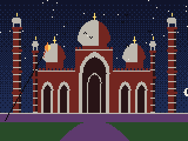
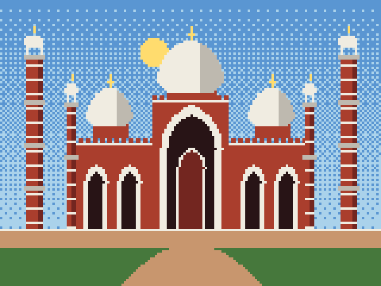
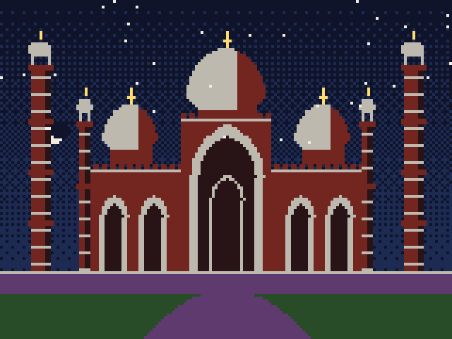
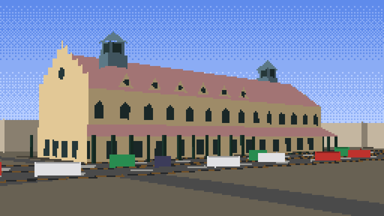
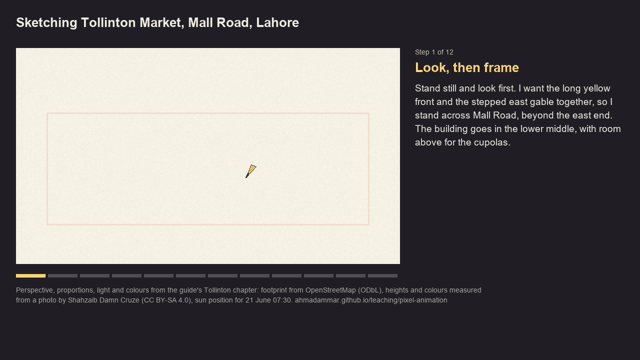
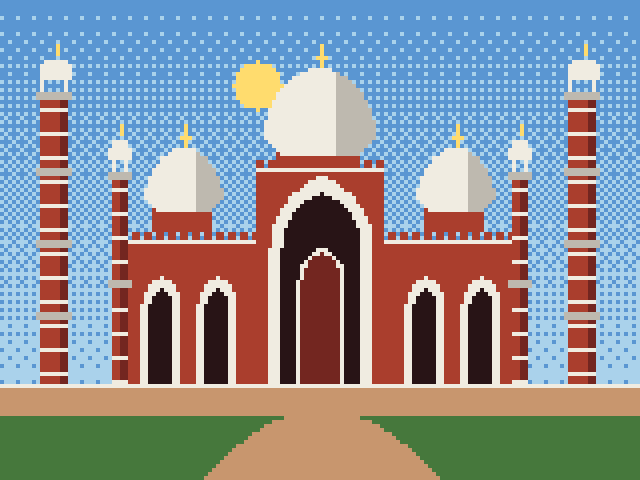

# Pixel Lahore

A procedural 8-bit animation of Badshahi Masjid, Lahore, written from first principles in Python and in plain C.
Nothing is drawn by hand: the mosque is a list of parametric components (onion domes, minarets, two-centred Mughal
arches, walls), mirrored about its centre line; the sun moves on a circle; the building swaps palette at night; a kite
hangs on an elastic string in gusty wind (semi-implicit Euler); and pigeons flock by Reynolds' three rules.



| Day | Night |
|---|---|
|  |  |

The tutorial that builds this step by step, with class, data-flow, entity–relationship and free-body diagrams, is
[Pixel animation from first principles](https://ahmadammar.github.io/teaching/pixel-animation/).

## A real place: Tollinton Market, Mall Road

Built from evidence: the footprint and streets from OpenStreetMap, heights and colours measured from an openly licensed
photograph, the sun's position for 21 June at 07:30, a sky colour from Planck's law and Rayleigh scattering, and traffic
from the Intelligent Driver Model. Step by step in the guide's
[Tollinton Market chapter](https://ahmadammar.github.io/teaching/pixel-animation/tollinton-market/).



Map data © OpenStreetMap contributors (ODbL). Colours and heights measured from *Tollinton Market-Damn Cruze-2018-4.jpg*
by Shahzaib Damn Cruze, Wikimedia Commons, CC BY-SA 4.0.

## An urban sketcher draws it

`python/sketcher.py` animates a sketcher drawing the Tollinton scene in the order sketchers work (frame, eye level,
vanishing points, the big box, roof, cupolas, rhythm, street, shadows first, lit faces, sky, life), with the thinking
beside the paper. Every line is a true perspective line of the measured model; hidden lines are removed with an id
buffer. Run `python sketcher.py PATH/TO/guides/pixel-animation/notebooks` (needs ffmpeg).
[Watch the video](https://ahmadammar.github.io/files/pixel-animation/sketcher.mp4).



## Run

Python (numpy and Pillow):

```bash
cd python
python pixel_lahore.py          # writes ../out/badshahi_day.png, badshahi_night.png and badshahi_day.gif
```

C (standard library only; writes PPM images):

```bash
cd c
gcc -O2 -Wall -o pixel_lahore pixel_lahore.c -lm
./pixel_lahore                  # writes still.ppm and frames/frame_000.ppm ... frame_119.ppm
```



The two versions integrate the same kite equations with the same time step and agree on its position after
12 seconds, (54.5, 20.1). Their stills differ in 531 of 19,200 pixels (2.8 %), all on the edges of round shapes,
where C rounds to whole pixels at different points.

## Layout

- `python/pixel_lahore.py`: canvas, palette, Bresenham line, inside-test shapes, Bayer dithering, components, scene,
  sun and night palette swap, kite and flock physics, PNG and GIF output.
- `c/pixel_lahore.c`: the same scene with a byte framebuffer and BGI-style calls (`putpixel`, `line`, `circle`,
  `bar`), sun, night swap and kite, PPM output.
- `docs/img/`: images in this README, produced by the code above.

## Next

Keyboard control of the kite, a second kite and a string-cutting rule (a *pech*), sprites and a scrolling Walled
City, and more landmarks (Government College, the National College of Arts, the Lahore Museum) stored as data.
